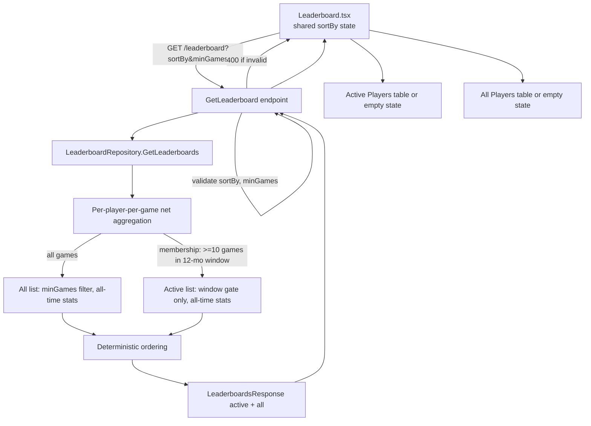

# Design Document

## Overview

This feature replaces the single-table Leaderboard with two stacked leaderboards served by one
API request:

- **Active Players** (top) — only players with at least `Active_Min_Games` (default **10**)
  distinct games inside a rolling 12-month window ending on the server's current date. The window
  and the 10-game rule are a **membership filter only**: once a player qualifies, their Games,
  Result, and Rate are computed from **all** their games (all-time), exactly as on the All list.
- **All Players** (bottom) — the existing all-time leaderboard, listing players with at least
  `All_Min_Games` distinct games across all dates (default **5**, overridable via `minGames`).

Both lists share one sort control (`net` or `rate`, default `rate`), the same columns
(rank, name, Games, Result, Rate), and are returned together in a single `GET /leaderboard`
response. Ordering is a deterministic total order with explicit tie-breaking. Invalid `sortBy`
or `minGames` values cause the request to be rejected with a 400 and neither list is returned.

The change touches three backend files and the frontend page/i18n:

- `poker_web_api/Data/LeaderboardRepository.cs` — add windowed Active computation, refactor the
  shared per-game-net aggregation, apply deterministic ordering.
- `poker_web_api/Data/LeaderboardEntry.cs` — unchanged record, reused for both lists; add a new
  response DTO.
- `poker_web_api/Endpoints/Public/GetLeaderboard.cs` — validate params, return both lists.
- `poker_frontend/src/pages/Leaderboard.tsx` — render two tables with shared sort state and
  independent empty states.
- `poker_frontend/src/i18n/translations.ts` — add headings and empty-state keys (en/ru).

### Design principles

- **Reuse, don't duplicate.** The existing per-player-per-game net aggregation
  (`CashOut − BuyIn`) is the correct core and is kept. The only new axis is an optional date
  filter on `Game.Date` and a stricter, explicit ordering.
- **Keep SQL simple, sort in memory.** As today, SQLite cannot `ORDER BY` a `decimal`, so the
  final ordering (including tie-breakers) happens client-side in C#. The dataset is one row per
  qualifying player, so this is negligible.
- **Minimal API surface change.** The route, verb, and `sortBy`/`minGames` params are preserved;
  only the response body changes shape (array → object with two arrays).

## Architecture



### Request flow

1. The page issues `GET /leaderboard?sortBy={net|rate}&minGames={n}` with a single shared
   `sortBy`.
2. The endpoint validates both params. On any invalid value it returns `400 Bad Request` with an
   error body and no list data (Req 5.3, 5.7).
3. The repository computes both lists in one call, sharing the per-game-net aggregation.
4. The endpoint returns `{ active, all }`, each an ordered array of rows.
5. The page renders two tables from the one response, each with its own empty state (Req 7).

### Current-date and window semantics

- `Current_Date` is `DateOnly.FromDateTime(DateTime.UtcNow)` evaluated once per request in the
  repository. The existing codebase uses `DateOnly` for `Game.Date` (see `Game.cs`) and
  `DateOnly.FromDateTime(DateTime.Now)` in `TestDbHelper`.
- The window start is `Current_Date.AddMonths(-12)`. `DateOnly.AddMonths` in .NET clamps to the
  last valid day of the target month when the original day-of-month does not exist there (e.g.
  `2024-02-29.AddMonths(-12)` → `2023-02-28`), which satisfies Req 1.1's last-day-of-month
  fallback with no custom code.
- A game qualifies for the window when `windowStart <= Game.Date <= Current_Date`, inclusive on
  both ends (Req 1.1, 1.2).

To keep the window testable without a clock abstraction, the repository method accepts an
optional `today` parameter (defaulting to `DateOnly.FromDateTime(DateTime.UtcNow)`). Tests pass a
fixed date; production passes nothing.

## Components and Interfaces

### Backend: `LeaderboardRepository`

The repository exposes a single method that returns both lists. The existing
`GetLeaderboard(minGames, sortBy)` is replaced by `GetLeaderboards(...)`; the per-game-net
aggregation and the sort step are factored into private helpers so Active and All share them.

```csharp
public class LeaderboardRepository
{
    public const int DefaultActiveMinGames = 10;
    public const int DefaultAllMinGames = 5;

    public LeaderboardRepository(PokerDbContext db);

    // Returns both lists, ordered per sortBy with deterministic tie-breaking.
    // allMinGames: threshold for the All list (default 5), applies to All only.
    // today: injectable current date for deterministic window tests.
    public Task<LeaderboardsResponse> GetLeaderboards(
        int allMinGames,
        string sortBy,
        DateOnly? today = null);
}
```

Internal structure:

- `LoadPlayerGameNets()` — executes the existing grouped query
  (`GameEntries` grouped by `{ PlayerId, GameId }`, `Net = Σ CashOut − Σ BuyIn`) and joins the
  `Game.Date` and the player `Name`, returning an in-memory list of
  `(PlayerId, Name, GameId, Date, Net)` rows. Loading once avoids a second DB round-trip for the
  window list. Missing CashOut/BuyIn totals naturally sum to zero (Req 2.2).
- `BuildEntries(rows, minGames)` — groups by player, keeps players with
  `distinct game count >= minGames`, computes `Games`, `Result = Σ Net`, `Rate = Σ Net / Games`.
  Used for both lists over **all** of the relevant players' rows: Active passes the all-time rows of
  the window-qualified players (membership having already been decided), All passes all rows.
- `OrderEntries(entries, sortBy)` — applies the deterministic ordering (below).

Active list: determine membership by counting each player's distinct in-window games
(`Date` in `[windowStart, today]`) and keeping players with `>= DefaultActiveMinGames`. Then build
entries from **all** of those players' rows (all-time), not just the windowed ones, so Active stats
match the All list. `minGames` from the request is **not** applied to Active (Req 5.5).

All list: `BuildEntries(rows, allMinGames)` over all rows (Req 3).

Distinct-game counting: because a player may have multiple entries (rebuys) in one game, the net
aggregation already collapses to one `(PlayerId, GameId)` net row per game, so counting rows per
player after aggregation equals the distinct game count (matches the existing
`CountsAsOneGame` test).

### Deterministic ordering (`OrderEntries`)

Replaces the current single-key `OrderByDescending`. Both lists use identical rules (Req 4):

- `sortBy == "net"`: order by `Result` desc, then `Rate` desc, then `Name` ascending (ordinal).
- `sortBy == "rate"` (default, and the fallback for any unrecognized value): order by `Rate`
  desc, then `Result` desc, then `Name` ascending (ordinal).

Because `Name` is unique per player and is the final key, the order is a **total** order (no two
distinct players compare equal). Name comparison uses `StringComparer.Ordinal` for a stable,
culture-independent tie-break.

Note: the endpoint rejects invalid `sortBy` before the repository runs (Req 5.3), so in
production `sortBy` is always `net` or `rate`. The repository still treats any non-`net` value as
`rate` to preserve the existing `InvalidSortBy_DefaultsToRate` unit-test behavior and to stay
robust if called directly.

### Backend: `GetLeaderboard` endpoint

Validation happens in the endpoint so the repository stays a pure computation.

```csharp
app.MapGet("/leaderboard", async (PokerDbContext db, string? sortBy, int? minGames) =>
{
    // sortBy: default "rate"; reject any provided value not in {net, rate} (Req 5.2, 5.3)
    var sort = sortBy ?? "rate";
    if (sort is not ("net" or "rate"))
        return Results.BadRequest(new { error = "invalid sortBy; expected 'net' or 'rate'" });

    // minGames: default 5; reject provided values < 1 (Req 5.6, 5.7).
    // Non-integer query values can't bind to int? and yield null here; guard covers < 1.
    var allMinGames = minGames ?? LeaderboardRepository.DefaultAllMinGames;
    if (allMinGames < 1)
        return Results.BadRequest(new { error = "invalid minGames; expected integer >= 1" });

    var repo = new LeaderboardRepository(db);
    var result = await repo.GetLeaderboards(allMinGames, sort);
    return Results.Ok(result);
})
.WithName("GetLeaderboard");
```

Invalid-parameter handling (Req 5.3, 5.7):

- A non-integer `minGames` (e.g. `minGames=abc`) fails `int?` model binding in minimal APIs,
  which produces a `400 Bad Request` automatically before the handler runs — satisfying "reject
  with an error, return neither list". An explicit guard handles integers `< 1`.
- An out-of-range `sortBy` is rejected with an explicit `400` and a descriptive message.
- In both reject paths the body carries only an error; neither `active` nor `all` is returned.

### Frontend: `Leaderboard.tsx`

- One `sortBy` state (`'net' | 'rate'`), default `'rate'` (Req 4.5, 6.6), shared by both tables.
- One `apiFetch<LeaderboardsResponse>(\`/leaderboard?sortBy=${sortBy}&minGames=5\`)` call on mount
  and whenever `sortBy` changes.
- A small `LeaderboardTable` sub-component renders heading + shared controls context + the table
  body, or an empty-state message when its `entries` array is empty. Rendered twice: Active then
  All (Req 6.1). Rank is the 1-based row index within each list (Req 4.6) — the existing `i + 1`
  pattern is kept, scoped per list.
- Empty states are evaluated independently per list: each table checks its own
  `entries.length === 0` (Req 7.1–7.4). The heading and the shared sort controls remain visible
  while a list is empty (Req 7.5).
- The sort buttons live once, above both tables, and update the shared `sortBy`.

The existing per-row rendering (Link to player, `CrownName`, colored net/rate, `toFixed`) is
reused unchanged inside the shared table component.

### Frontend: i18n keys

Existing keys `leaderboard.title`, `leaderboard.net`, `leaderboard.rate`, `leaderboard.col.name`,
`leaderboard.col.games` are kept. New keys (Req 6.2, 6.3, 7.1, 7.2):

| Key | en | ru |
| --- | --- | --- |
| `leaderboard.active` | Active Players | Активные игроки |
| `leaderboard.all` | All Players | Все игроки |
| `leaderboard.empty.active` | No active players yet | Пока нет активных игроков |
| `leaderboard.empty.all` | No players yet | Пока нет игроков |

Russian strings follow the file's guideline of staying close to the English length.

## Data Models

No database schema changes. All inputs already exist: `Game.Date` (`DateOnly`), `GameEntry.Type`
(`EntryType.BuyIn`/`CashOut`), `GameEntry.Amount` (`decimal`), `Player.Name`.

The row record is reused unchanged for both lists:

```csharp
// poker_web_api/Data/LeaderboardEntry.cs (unchanged)
public record LeaderboardEntry(string Name, int Games, decimal Result, double Rate);
```

New response DTO wrapping both lists (Req 5.1):

```csharp
// poker_web_api/Data/LeaderboardsResponse.cs (new)
public record LeaderboardsResponse(
    IReadOnlyList<LeaderboardEntry> Active,
    IReadOnlyList<LeaderboardEntry> All);
```

Serialized JSON (System.Text.Json camelCases by default in ASP.NET minimal APIs):

```json
{
  "active": [{ "name": "Alice", "games": 12, "result": 340, "rate": 28.33 }],
  "all":    [{ "name": "Alice", "games": 57, "result": 910, "rate": 15.96 }]
}
```

Frontend type:

```ts
interface LeaderboardEntry {
  name: string;
  games: number;
  result: number;
  rate: number;
}
interface LeaderboardsResponse {
  active: LeaderboardEntry[];
  all: LeaderboardEntry[];
}
```

Note: the current frontend `LeaderboardEntry` carries an unused `positionDelta` field that the
API does not send; it is dropped in the new type.

## Correctness Properties

*A property is a characteristic or behavior that should hold true across all valid executions of a
system — essentially, a formal statement about what the system should do. Properties serve as the
bridge between human-readable specifications and machine-verifiable correctness guarantees.*

These properties target the pure computation in `LeaderboardRepository` (windowing, aggregation,
and ordering), which is well-suited to property-based testing. Tests construct an in-memory
database with generated games/entries (via `TestDbHelper`) and a fixed `today`, then assert each
property. UI layout, i18n strings, API error handling, and default-constant behaviors are verified
by example/component/endpoint tests instead (see Testing Strategy).

### Property 1: Window scope is inclusive on both endpoints

*For any* current date and *any* player, a game counts toward Active **membership** exactly when
its `Game_Date` is on or after `today.AddMonths(-12)` and on or before `today`; a game dated one
day before the window start or one day after `today` does not count toward the 10-game membership
gate. (The window gates membership only; a qualified player's `Games` still reflects their
all-time distinct game count.)

**Validates: Requirements 1.1, 1.2**

### Property 2: Active membership follows the game-count threshold

*For any* generated data and current date, a player appears in the Active list if and only if the
number of that player's distinct in-window games is greater than or equal to `Active_Min_Games`
(10).

**Validates: Requirements 1.3, 1.4**

### Property 3: Per-game net equals cash-outs minus buy-ins

*For any* multiset of a player's buy-in and cash-out entries within a single game, the computed
per-game net equals the sum of cash-out amounts minus the sum of buy-in amounts, where an absent
cash-out or buy-in side contributes zero.

**Validates: Requirements 2.2**

### Property 4: Result and Rate are a consistent aggregation of in-scope games

*For any* player appearing on a list, that player's `Result` equals the sum of their per-game nets
over the games in that list's scope, and `Rate` equals `Result` divided by `Games` (with
`Games >= 1`).

**Validates: Requirements 2.3, 2.4, 3.5, 3.6**

### Property 5: Active stats are all-time (include out-of-window games)

*For any* player qualified for the Active list, that player's Active `Games`, `Result`, and `Rate`
aggregate over **all** of their games including those dated outside the Qualification_Window, and
are identical to the stats that player shows on the All list.

**Validates: Requirements 2.1, 2.3, 2.4**

### Property 6: All membership follows the all-time game-count threshold

*For any* generated data and *any* `All_Min_Games` value greater than or equal to 1, a player
appears in the All list if and only if that player's all-time distinct game count is greater than
or equal to `All_Min_Games`, using all games regardless of date.

**Validates: Requirements 3.1, 3.3, 3.4**

### Property 7: Repeated entries in one game count as a single game

*For any* player with any number of buy-in or cash-out entries spread across a set of games, the
player's `Games` value on either list equals the number of distinct games they participated in
(within that list's scope), not the number of entries.

**Validates: Requirements 3.2**

### Property 8: Each list is a deterministic total ordering

*For any* generated data, current date, and sort mode in {"net", "rate"}, each returned list is a
permutation of its qualifying players in which every adjacent pair satisfies the sort comparator —
for "net": `Result` descending, then `Rate` descending, then `Name` ascending; for "rate":
`Rate` descending, then `Result` descending, then `Name` ascending — and because `Name` is unique
the ordering is total (no two distinct players compare equal).

**Validates: Requirements 4.1, 4.2, 4.3, 4.4**

### Property 9: The minGames parameter affects only the All list

*For any* generated data and *any* two `All_Min_Games` values greater than or equal to 1, the
Active list (its membership, order, and every row's stats) is identical for both values; only the
All list may differ.

**Validates: Requirements 5.5**

## Error Handling

- **Invalid `sortBy`** (not `net` or `rate`): the endpoint returns `400 Bad Request` with a JSON
  error body and no list data (Req 5.3). Validation occurs before the repository runs.
- **Invalid `minGames`**:
  - Non-integer values fail `int?` model binding in the minimal API, producing an automatic
    `400 Bad Request` before the handler body executes (Req 5.7).
  - Integer values `< 1` are rejected by an explicit guard returning `400 Bad Request` with an
    error body (Req 5.7).
  - In both cases neither `active` nor `all` is returned.
- **No qualifying players**: not an error. The repository returns empty arrays; the page renders
  per-list empty states (Req 7). An empty database yields `{ active: [], all: [] }` (consistent
  with the existing `EmptyDatabase_ReturnsEmptyList` behavior).
- **Missing CashOut or BuyIn side for a player in a game**: not an error. The absent side sums to
  zero, so net is well-defined (Req 2.2; matches the existing `OnlyBuyInsNoCashOut` test).
- **Frontend fetch failure**: the page keeps the existing `.catch(() => {})` behavior so a failed
  request does not crash the view; empty-state messages remain distinct from this error path
  (Req 7.1, 7.2). No new error UI is introduced by this feature.

## Testing Strategy

The repository logic is pure and input-driven, so it gets property-based tests plus targeted
example tests. The endpoint and the React page get example/component tests, since their behavior
(validation, layout, i18n, empty states, defaults) does not vary meaningfully across large input
spaces.

### Property-based tests (repository)

- Library: **FsCheck** with **FsCheck.Xunit** (`[Property]`), the standard property-based testing
  library for .NET/xUnit. Property testing will not be implemented from scratch.
- Location: new `poker_web_api.Tests/Unit/LeaderboardRepositoryPropertyTests.cs`, alongside the
  existing `LeaderboardRepositoryTests.cs`, reusing `TestDbHelper` to build in-memory data and
  passing a fixed `today` into `GetLeaderboards`.
- Each property runs a **minimum of 100 iterations** (FsCheck default is 100; raise via
  `MaxTest` if needed).
- Each test is tagged with a comment referencing its design property, format:
  `// Feature: dual-leaderboard, Property {number}: {property_text}`.
- One property-based test per correctness property (Properties 1–9). Generators produce random
  players, games with random `DateOnly` values (spanning inside and outside the window), random
  buy-in/cash-out multisets (including empty sides and rebuys), random `today`, and random
  `allMinGames >= 1`.

### Example and edge-case unit tests (repository)

Keep the existing `LeaderboardRepositoryTests.cs` cases (adapted to the new `GetLeaderboards`
return shape — read `response.All` where they previously read the flat list). Add focused examples
the properties don't pin down:

- Active default threshold boundary: 9 in-window games excluded, exactly 10 included (Req 1.5).
- All default threshold applied when `allMinGames = 5` (Req 5.6).
- Last-day-of-month window fallback: `today = 2024-02-29` yields window start `2023-02-28`
  (sanity-checks the `DateOnly.AddMonths` behavior relied on in Req 1.1).
- A player present in the All list but absent from the Active list (and the reverse), confirming
  the two lists are computed independently.

### Endpoint tests (`GetLeaderboard`)

- Response contains both `active` and `all` arrays, each row carrying `name`, `games`, `result`,
  `rate` (Req 5.1, 5.4).
- No `sortBy` → ordered by rate (Req 4.5); no `minGames` → All threshold 5 (Req 5.6).
- `sortBy=bogus` → `400`, no lists (Req 5.3); `minGames=0`, `minGames=-3`, `minGames=abc` → `400`,
  no lists (Req 5.7).

### Frontend component tests (`Leaderboard.tsx`)

- Active table renders above All (Req 6.1); columns in order rank, name, Games, Result, Rate
  (Req 6.4); ranks are 1..n per list (Req 4.6).
- English and Russian headings resolve for `leaderboard.active` / `leaderboard.all` (Req 6.2, 6.3).
- Shared sort controls default to rate on load (Req 6.6) and re-sort both tables when toggled
  (Req 6.5).
- Empty states render independently: active empty + all non-empty shows the active empty-state and
  the all rows, and vice versa (Req 7.1–7.4); heading and controls stay visible while empty
  (Req 7.5).
